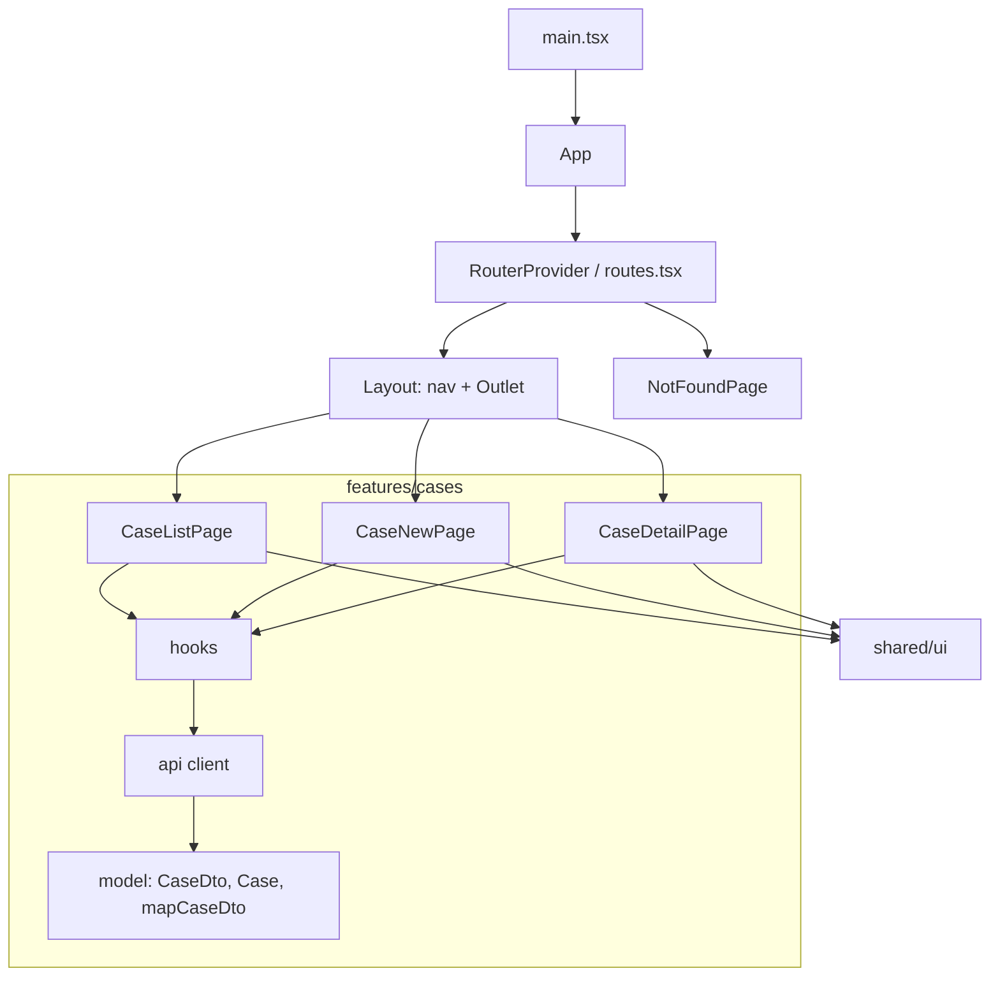
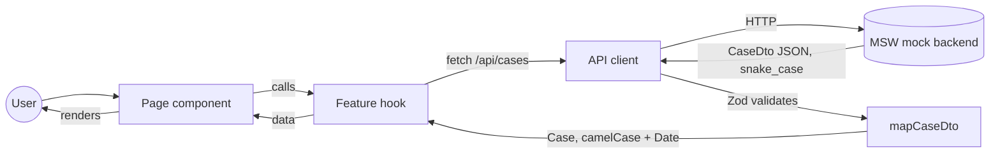

# CaseFlow Architecture

CaseFlow is a React SPA (see [ADR 0001](adr/0001-rendering-strategy.md)) organised by feature. It talks to a mock backend (MSW) that follows the API contract in the brief.

## Component diagram

## Data-flow diagram

Invalid DTOs are rejected at the boundary, so the UI only ever sees valid `Case` objects.

## State taxonomy

| State type              | What it holds in CaseFlow                                         | Tool                                          | Why                                           |
| ----------------------- | ----------------------------------------------------------------- | --------------------------------------------- | --------------------------------------------- |
| **Server state**        | Cases, users and customers from `/api`                            | TanStack Query                                | Caching, loading and error states, refetching |
| **URL state**           | List search `q`, `status`, `priority`, `sort`, `page`; case `:id` | React Router (`useSearchParams`, `useParams`) | Shareable, bookmarkable, survives refresh     |
| **Form state**          | Create and edit case form fields and validation errors            | React Hook Form with the Zod schema           | Handles field state and validation            |
| **Local UI state**      | Open dialogs, dropdowns, toggles                                  | `useState`                                    | Only one component needs it                   |
| **Global client state** | Simulated current role (viewer, agent, admin)                     | React Context                                 | Needed across the whole app, rarely change    |
